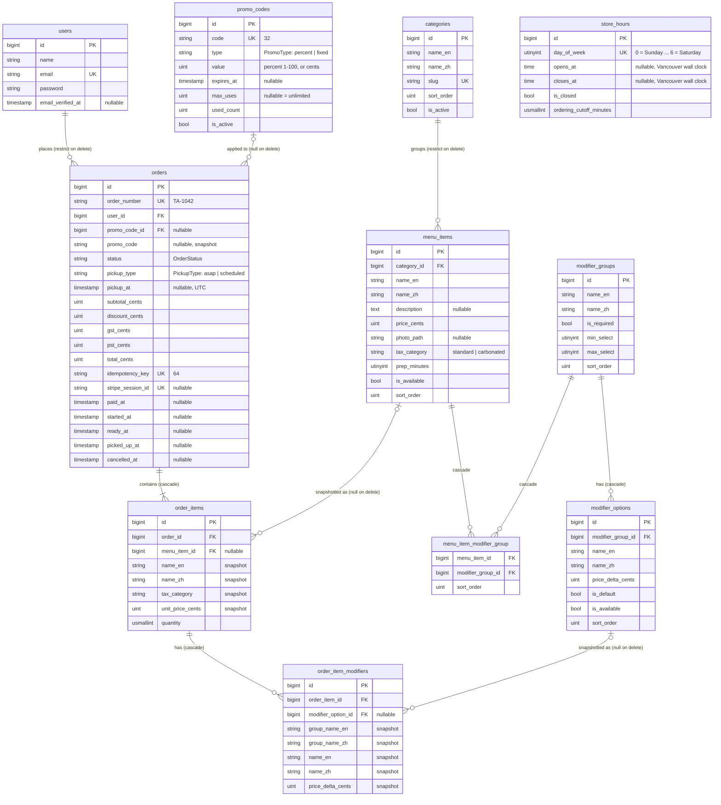

# Entity relationship diagram

Application tables only. Framework tables (`cache`, `jobs`, `sessions`, `passkeys`, `password_reset_tokens`) and the spatie/laravel-permission tables (`roles`, `permissions`, and their pivots) are left out.

## Notes

- All `*_cents` columns are unsigned integers. Money is formatted only in views.
- All `timestamp` columns are UTC. `store_hours.opens_at` and `closes_at` are the exception: they are America/Vancouver wall-clock times, so DST changes don't shift them.
- Orders snapshot names, tax category, prices, and the promo code at order time. Deleting a menu item, modifier option, or promo code sets the foreign key to null and leaves the snapshot unchanged.
- Every table except `order_item_modifiers` and `menu_item_modifier_group` also has `created_at` and `updated_at`. They're left out above to keep the diagram short.
- Index on `orders (status, created_at)` for the barista board and order history.
